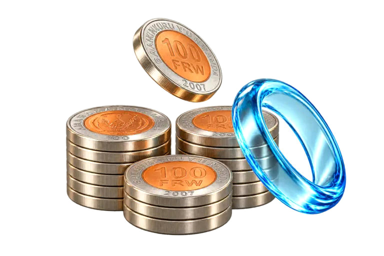

# Dignity — Overview

The logged-in Overview screen for Dignity: a glass shell over a soft blue field, with two switchable navigation layouts (floating top bar and sidebar rail), glass KPI cards, a sales chart, payment mix, transactions, stock alerts, and business apps — all driven by local demo data for Kivu Market.



## Quick start

**Prerequisites:** Node.js 20+, npm

```bash
npm install
npm run dev      # http://localhost:3000
```

| Script             | Command           | Purpose                          |
| ------------------ | ----------------- | -------------------------------- |
| Development        | `npm run dev`     | Start Next.js dev server         |
| Production build   | `npm run build`   | Optimized build (Turbopack)      |
| Start              | `npm run start`   | Serve production build           |
| Lint               | `npm run lint`    | ESLint                           |
| Type check         | `npm run typecheck` | TypeScript `--noEmit`          |

## Tech stack

| Layer        | Technology                                      |
| ------------ | ----------------------------------------------- |
| Framework    | Next.js 16.4.5 (App Router, Turbopack)          |
| UI           | React 19, Tailwind CSS 4, lucide-react icons    |
| Typography   | Self-hosted Google Sans (variable, 100–900) + Google Sans Code |
| Styling      | CSS custom properties (no CSS-in-JS), Lightning CSS |
| State        | React Context + `localStorage`/`cookie` persistence |

## Features

- **Two shells, one screen** — floating top bar (default) or sidebar rail; switched from the Customize panel and persisted via cookie + `localStorage` so the server renders the same shell on reload (no flash).
- **Customizable glass** — a 0–100 "Glass level" slider drives blur, saturation, tint, edge highlight, and ambient strength across the shell with four presets (Solid, Soft, Balanced, Liquid). Saved per device.
- **Overview dashboard** — KPI cards (Net sales, Customer credit), stat row (Transactions, Low-stock, Quick actions), Sales performance chart, Payment mix donut, Recent sales table, Low-stock alerts, Business apps grid.
- **Business scope** — Kivu Market demo workspace with branch switcher, period selector, and live totals derived from `src/lib/data.ts`.
- **Responsive** — verified at 1440, 1024, and 390 px; mobile gets a frosted bottom nav.
- **Accessible motion/transparency** — solid surfaces under `prefers-reduced-transparency` or when `backdrop-filter` is unsupported; ambient drift and entrance animations collapse under `prefers-reduced-motion`.

## Project structure

```
.
├── public/
│   ├── assets/            # KPI artwork (coin stacks, credit wallet)
│   └── brand/             # Dignity logos, RWF coin
├── src/
│   ├── app/
│   │   ├── layout.tsx     # fonts, page canvas, ambient blobs, glass cookie read
│   │   ├── page.tsx       # Overview composition + layout/glass preference
│   │   ├── globals.css    # glass recipe, tokens, KPI/chip/shell styles, fallbacks
│   │   └── icon.png
│   ├── components/
│   │   ├── layout/        # layout-provider, layout-shell, glass-provider
│   │   ├── dashboard/     # KPI cards, stat row, chart, payment mix, table, stock, apps
│   │   ├── top-nav.tsx    # floating top-bar shell
│   │   ├── top-bar.tsx    # sidebar shell header
│   │   ├── app-rail.tsx   # sidebar shell rail
│   │   ├── mobile-nav.tsx # frosted bottom nav
│   │   ├── customize-button.tsx  # Layout + Glass level panel
│   │   └── business-*.tsx # business provider + switcher
│   ├── fonts/             # self-hosted WOFF2 (no external font requests)
│   └── lib/
│       ├── appearance.ts  # glass cookie/storage keys, presets, clamp/parse helpers
│       └── data.ts        # demo data (Kivu Market)
├── .gitignore
├── package.json
└── README.md
```

## Design system

**Brand (kept intact):**

| Token  | Value     | Usage                              |
| ------ | --------- | ---------------------------------- |
| Blue   | `#094197` | Primary actions, active states     |
| Ink    | `#143768` | Headings, body text                |
| Copper | `#a05c1e` | Stock and credit accents           |

Glass is the **shell** — top bar, rail, mobile nav, KPI cards, chips, and controls. Dense data surfaces (chart, table, lists) use a soft blue-white gradient: near-opaque at the default (55) so numbers stay high-contrast, then open up after 60 so full Liquid (100) is translucent everywhere, not just the shell.

**Card artwork:** the supplied 3D renders in `public/assets/` (`net-sales-coins.png`, `customer-credit-wallet.png`) were knocked out to true transparency (border flood-fill) so the KPI glass shows through behind the coins/wallet. They are served `unoptimized` because the image optimizer re-encodes to WebP and flattens the alpha channel onto white, which paints an opaque box over the glass.

### Glass level

The Customize panel sets `--glass-level` (0–100) on `<html>`; every glass token derives from it:

| Preset   | Range | Character                                               |
| -------- | ----- | ------------------------------------------------------- |
| Solid    | 0     | No blur, near-opaque, ambient motion off                |
| Soft     | 1–49  | Light frost, subtle tint                                |
| Balanced | 50–84 | Default 55 — frosted with gentle sheen                  |
| Liquid   | 85–100| Near-clear optical glass with bright rim (reference)    |

- **Persistence:** `dignity_glass` in both `localStorage` and a cookie; the root layout reads the cookie to set the initial level on first paint.
- **Tokens:** `--glass-blur` (0→34px), `--glass-saturate` (1→2), `--glass-tint` / `--glass-tint-soft` / `--glass-bar`, `--glass-edge`, `--glass-sheen`, `--glass-soft-tint` / `--glass-soft-tint-soft` / `--glass-soft-sheen` (data cards), `--ambient-strength`.
- **Curve:** gentle until 60, then opens sharply so Liquid is genuinely clear.
- **Fallbacks:** `data-glass="solid"`, reduced-transparency, and no-`backdrop-filter` all force solid surfaces.

## Demo data

All figures are supplied demo data (Kivu Market) in `src/lib/data.ts`:

- Net sales **166,100 RWF**, Gross sales 166,100 RWF, Returns 0 RWF
- Customer credit outstanding **9,400 RWF**
- **27** transactions; **2** low-stock items (Olive oil, Oat cookies)
- Sales chart: 9 days (Oct 7–15); Oct 10 and Oct 14 show zero-sales markers instead of dropping from the axis; daily values sum to 166,100 RWF

## Verified

- `npm run lint`, `npm run typecheck`, `npm run build` — all pass
- Browser QA in Chromium (1440 / 1024 / 390 px): top bar ↔ sidebar switch, glass slider live update (default 55, Liquid 100, Solid 0), persistence after reload, no horizontal overflow, no console/page errors
- Reduced motion/transparency: blur and animation off as specified

## Repository

https://github.com/IsMushi/Dignity
