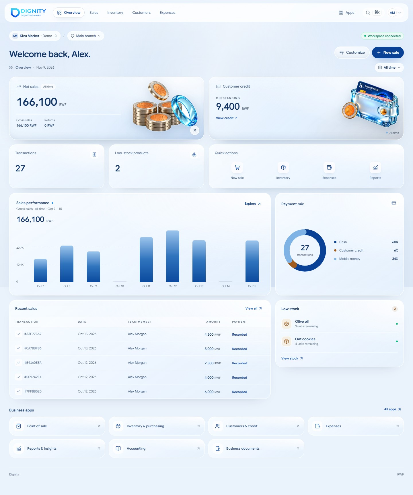

# Dignity — Overview

The logged-in Overview screen for Dignity: a full-page liquid-glass dashboard over a photographic sky canvas, with two switchable navigation layouts (floating top bar and sidebar rail), glass KPI cards, a sales chart, payment mix, transactions, stock alerts, business apps, and a dedicated Appearance screen for the canvas, text and accent colours — all driven by local demo data for Kivu Market.



## Quick start

**Prerequisites:** Node.js 20+, npm

```bash
npm install
npm run dev      # http://localhost:3000
```

| Script             | Command           | Purpose                          |
| ------------------ | ----------------- | -------------------------------- |
| Development        | `npm run dev`     | Start Next.js dev server         |
| Production build   | `npm run build`   | Optimized build (Turbopack)      |
| Start              | `npm run start`   | Serve production build           |
| Lint               | `npm run lint`    | ESLint                           |
| Type check         | `npm run typecheck` | TypeScript `--noEmit`          |
| Test               | `npm test`        | Node test runner (glass + theme helpers) |

## Tech stack

| Layer        | Technology                                      |
| ------------ | ----------------------------------------------- |
| Framework    | Next.js 16.4.5 (App Router, Turbopack)          |
| UI           | React 19, Tailwind CSS 4, lucide-react icons    |
| Typography   | Self-hosted Google Sans (variable, 100–900) + Google Sans Code |
| Styling      | CSS custom properties (no CSS-in-JS), Lightning CSS |
| State        | React Context + `localStorage`/`cookie` persistence |

## Features

- **Two shells, one screen** — floating top bar (default) or sidebar rail; switched from the Customize panel and persisted via cookie + `localStorage` so the server renders the same shell on reload (no flash).
- **Real routes** — `/` Overview, `/sales`, `/inventory`, `/customers`, `/expenses`, plus `/appearance`. Every nav link is a Next.js route, and the liquid indicator derives its active item from the current pathname, so reloads, shared links and the back button highlight the right section.
- **Customizable glass** — a 0–100 "Glass level" slider drives blur, saturation, tint, edge highlight, and refraction across the dashboard, with four clickable presets (Solid, Soft, Balanced, Liquid) for one-tap jumps. Saved per device.
- **Appearance screen** — `/appearance` sets the canvas, text and accent colours with live WCAG contrast badges and four presets (Sky, Sand, Mint, Graphite). The canvas can stay photographic, become a flat colour, or use a background image uploaded from your computer.
- **Overview dashboard** — KPI cards (Net sales, Customer credit), stat row (Transactions, Low-stock, Quick actions), Sales performance chart, Payment mix donut, Recent sales table, Low-stock alerts, Business apps grid. The Payment mix donut and legend derive their colours from the Appearance accent, so they follow the chosen theme instead of a fixed palette.
- **Business scope** — Kivu Market demo workspace with a branch switcher and period display. The three sample businesses share the same demo figures; switching changes the workspace label, not the totals.
- **Responsive** — verified at 1440, 1024, and 390 px; mobile gets a glass bottom nav.
- **Accessible motion/transparency** — solid surfaces under `prefers-reduced-transparency` or when `backdrop-filter` is unsupported; entrance animations collapse under `prefers-reduced-motion`.

## Project structure

```
.
├── docs/
│   └── overview.jpg       # screenshot used at the top
├── public/
│   ├── assets/            # KPI artwork (coin stacks, credit wallet)
│   └── brand/             # Dignity logos, RWF coin
├── src/
│   ├── app/
│   │   ├── layout.tsx     # fonts, page canvas, SSR theme/glass cookie read
│   │   ├── page.tsx       # Overview composition via shared providers
│   │   ├── sales/         # Sales route
│   │   ├── inventory/     # Inventory route
│   │   ├── customers/     # Customers route
│   │   ├── expenses/      # Expenses route
│   │   ├── appearance/    # Appearance route (canvas, text, accent, image)
│   │   ├── globals.css    # imports the layered style modules
│   │   ├── styles/        # tokens, glass, surfaces, appearance, fallbacks
│   │   └── icon.png
│   ├── components/
│   │   ├── appearance/    # Appearance screen, swatches, preview
│   │   ├── layout/        # layout/glass/theme providers, shell, lens
│   │   ├── dashboard/     # KPI cards, stat row, chart, payment mix, table, stock, apps
│   │   ├── top-nav.tsx    # floating top-bar shell
│   │   ├── top-bar.tsx    # sidebar shell header
│   │   ├── app-rail.tsx   # sidebar shell rail
│   │   ├── mobile-nav.tsx # frosted bottom nav
│   │   ├── customize-button.tsx  # layout panel + Appearance link
│   │   ├── glass-level-control.tsx # shared Glass level slider
│   │   ├── section-page.tsx # shared shell for the section routes
│   │   └── business-*.tsx # business provider + switcher
│   ├── fonts/             # self-hosted WOFF2 (no external font requests)
│   └── lib/
│       ├── appearance.ts  # glass cookie/storage keys, presets, clamp/parse helpers
│       ├── navigation.ts  # nav href matching (exact root, prefix sections)
│       ├── theme.ts       # theme presets, palette maths, serialization, CSS vars
│       ├── theme-image.ts # browser resize/compress for uploaded backgrounds
│       ├── preferences.ts # shared preference stores + cookie/localStorage writes
│       ├── use-liquid-nav.ts # URL-driven active item + sliding indicator
│       ├── use-dismissable-menu.ts # dropdown open/close + outside/Escape handling
│       └── data.ts        # demo data (Kivu Market)
├── tests/
│   ├── appearance.test.mts # Node tests for the glass-level helpers
│   ├── navigation.test.mts # Node tests for nav hrefs and active matching
│   └── theme.test.mts      # Node tests for presets, contrast, parsing, images
├── .gitignore
├── package.json
└── README.md
```

## Design system

**Brand (kept intact):**

| Token  | Value     | Usage                              |
| ------ | --------- | ---------------------------------- |
| Blue   | `#094197` | Primary actions, active states     |
| Ink    | `#143768` | Headings, body text                |
| Copper | `#a05c1e` | Stock and credit accents           |

Liquid glass covers the **entire dashboard** — shell, controls, KPI cards, charts, tables, lists, and business apps. At the default Liquid level, the sky shows through the translucent panels; light blur, directional rims, and refraction provide the glass effect. The default canvas is a photographic sky (`public/backgrounds/sky-background.webp` over `#8EBFEE`) with brand-colour wash bands. Glass needs backdrop variation to refract, so the flat colour themes and custom colours rely on the tint, rims and lens instead; no gradient fills are used anywhere.

### Appearance

The Appearance screen (`/appearance`, linked from the Customize panel) owns the canvas, text and accent colours:

- **Presets:** Sky (photo), Sand, Mint and Graphite (flat). Sand and Mint accents are darkened until they clear 4.5:1 against their canvas.
- **Custom colours:** background, text and accent each have a picker and hex field. WCAG badges show text-on-canvas and accent-on-canvas contrast live.
- **Derived tokens:** muted text, lines, hover shades and the deep brand colour are mixed from the three choices; `--color-on-brand` flips button labels between white and dark ink for readability. Dark canvases switch `--surface-rgb` and shadows so the glass stays readable.
- **Background image:** upload a JPG/PNG/WebP/GIF up to 20 MB. `src/lib/theme-image.ts` resizes the longest edge to 1600 px and re-encodes to WebP (JPEG fallback) in the browser. The data URL lives in `localStorage` only; the cookie keeps just the colours, so it stays under the 4 KB limit and the image arrives after hydration.
- **Persistence:** `dignity_theme` in `localStorage` (full theme including the image) and a cookie (colours only). The root layout reads the cookie for the first paint and serializes the same variables onto `<html>`.

**Card artwork:** the supplied 3D renders in `public/assets/` (`net-sales-coins.png`, `customer-credit-wallet.png`) were knocked out to true transparency (border flood-fill) so the KPI glass shows through behind the coins/wallet. They are served `unoptimized` because the image optimizer re-encodes to WebP and flattens the alpha channel onto white, which paints an opaque box over the glass. At Liquid the artwork drops behind the glass layer, so the KPI lens bends it at the bezel.

### Glass level

The Customize panel sets `--glass-level` (0–100) on `<html>`; every glass token derives from it:

| Preset   | Range | Character                                               |
| -------- | ----- | ------------------------------------------------------- |
| Solid    | 0     | No blur, near-opaque, ambient motion off                |
| Soft     | 1–49  | Light frost, subtle tint                                |
| Balanced | 50–84 | Frosted mid levels for high-contrast reading        |
| Liquid   | 85–100| Default 100 — clear optical glass: lens-bent backdrop, bright specular rim |

- **Persistence:** `dignity_glass` in both `localStorage` and a cookie; the root layout reads the cookie to set the initial level on first paint.
- **Tokens:** `--glass-blur` (0px base; Liquid data panels use a 2px blur fallback and shell chrome 4px), `--glass-saturate` (1→2), `--glass-tint` / `--glass-tint-soft` (0.92 → 0.14), `--glass-bar` (0.60 at default → 0.16 at Liquid), `--glass-edge`, `--glass-sheen` (capped at 0.36), `--glass-panel` (0.98 → 0.62 for readable menus), `--glass-soft-tint` / `--glass-soft-tint-soft` / `--glass-soft-sheen` (data cards), `--liquid-wash` (fades in 85→100; hidden over a custom uploaded image so the photo stays crisp).
- **Curve:** gentle until 60, then opens sharply toward Liquid. Chromium applies SVG lens refraction across the glass surfaces; other browsers use light blur, translucent tint, and directional rims.
- **Liquid lens:** a [rounded-bezel displacement map](public/glass-lens.png) referenced by an SVG `feDisplacementMap` bends the backdrop at the KPI bezel (the map is tuned for the card aspect, so chrome uses a plain blur instead). Chromium applies it through `backdrop-filter`; Firefox and Safari keep the clear tint + rim fallback because they parse `url()` filters but do not paint them. `data-lens` is set in JS for that reason.
- **Fallbacks:** `data-glass="solid"`, reduced-transparency, and no-`backdrop-filter` all force solid surfaces, including dropdown panels, and keep the KPI artwork above the glass.

## Demo data

All figures are supplied demo data (Kivu Market) in `src/lib/data.ts`:

- Net sales **166,100 RWF**, Gross sales 166,100 RWF, Returns 0 RWF
- Customer credit outstanding **9,400 RWF**
- **27** transactions; **2** low-stock items (Olive oil, Oat cookies)
- Sales chart: 9 days (Oct 7–15); Oct 10 and Oct 14 show zero-sales markers instead of dropping from the axis; daily values sum to 166,100 RWF

## Verified

- `npm run lint`, `npm run typecheck`, `npm run build` — all pass
- `npm test` — 35 Node tests covering glass clamping/parsing/labels, nav route matching, theme presets, contrast, theme parsing and cookie/image serialization, hue rotation, and canvas mode
- Route smoke check against `next start`: `/`, `/sales`, `/inventory`, `/customers`, `/expenses` and `/appearance` all return 200, and each section route marks only its own nav link as `aria-current="page"`
- Browser QA in Chromium (1440 / 1024 / 390 px): top bar ↔ sidebar switch, clickable presets and slider (default 100 Liquid, Solid 0), label range at 10% reads Soft, SVG lens refraction on Liquid shell/data surfaces, 84 still Balanced and 85 switches to Liquid, `data-lens` + `url(#dignity-lens)` on the KPI cards, glass Customize/business panels, persistence after reload, no horizontal overflow, no console/page errors
- Appearance colour maths, presets, cookie/localStorage serialization and canvas mode are covered by Node tests; the upload → resize → preview path still needs a manual browser check in this environment
- Reduced motion/transparency: blur and animation off as specified, including `.glass-panel`, and KPI artwork stays above the opaque surface

## Repository

https://github.com/IsMushi/Dignity
