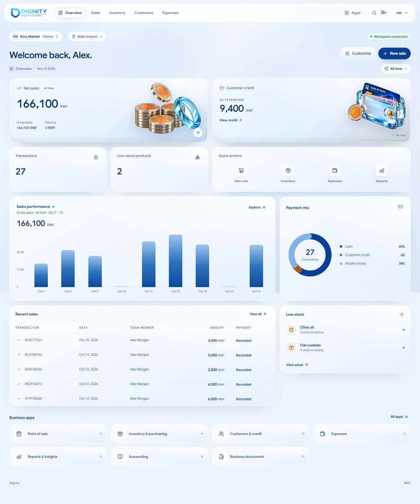

# Dignity — Overview

The logged-in Overview screen for Dignity: a full-page liquid-glass dashboard over a photographic sky canvas, with two switchable navigation layouts (floating top bar and sidebar rail), glass KPI cards, a sales chart, payment mix, transactions, stock alerts, business apps, and a dedicated Appearance screen for the canvas, text and accent colours — all driven by local demo data for Kivu Market.



## Quick start

**Prerequisites:** Node.js 20+, npm

```bash
npm install
npm run dev      # http://localhost:3000
```

| Script             | Command           | Purpose                          |
| ------------------ | ----------------- | -------------------------------- |
| Development        | `npm run dev`     | Start Next.js dev server         |
| Production build   | `npm run build`   | Optimized build (Turbopack)      |
| Start              | `npm run start`   | Serve production build           |
| Lint               | `npm run lint`    | ESLint                           |
| Type check         | `npm run typecheck` | TypeScript `--noEmit`          |
| Test               | `npm test`        | Node test runner (glass + theme helpers) |

## Tech stack

| Layer        | Technology                                      |
| ------------ | ----------------------------------------------- |
| Framework    | Next.js 16.4.5 (App Router, Turbopack)          |
| UI           | React 19, Tailwind CSS 4, lucide-react icons    |
| Typography   | Self-hosted Google Sans (variable, 100–900) + Google Sans Code |
| Styling      | CSS custom properties (no CSS-in-JS), Lightning CSS |
| State        | React Context + `localStorage`/`cookie` persistence |

## Features

- **Two shells, one screen** — floating top bar (default) or sidebar rail; switched from the Customize panel and persisted via cookie + `localStorage` so the server renders the same shell on reload (no flash).
- **Real routes** — `/` Overview, `/sales`, `/inventory`, `/customers`, `/expenses`, plus `/appearance`. Every nav link is a Next.js route, and the liquid indicator derives its active item from the current pathname, so reloads, shared links and the back button highlight the right section.
- **Customizable glass** — a 0–100 "Glass level" slider drives tint, saturation, edge highlight, and refraction across the dashboard, with four clickable presets (Solid, Soft, Balanced, Liquid) for one-tap jumps. Saved per device.
- **Appearance screen** — `/appearance` sets the canvas, text and accent colours with live WCAG contrast badges and four presets (Sky, Sand, Mint, Graphite). The canvas can use one of four bundled photo backgrounds, become a flat colour, or use an image uploaded from your computer.
- **Overview dashboard** — KPI cards (Net sales, Customer credit), stat row (Transactions, Low-stock, Quick actions), Sales performance chart, Payment mix donut, Recent sales table, Low-stock alerts, Business apps grid. The Payment mix donut and legend derive their colours from the Appearance accent, so they follow the chosen theme instead of a fixed palette.
- **Business scope** — Kivu Market demo workspace with a branch switcher and period display. The three sample businesses share the same demo figures; switching changes the workspace label, not the totals.
- **Responsive** — verified at 1440, 1024, and 390 px; mobile gets a glass bottom nav.
- **Accessible motion/transparency** — solid surfaces under `prefers-reduced-transparency` or when `backdrop-filter` is unsupported; entrance animations collapse under `prefers-reduced-motion`.

## Project structure

```
.
├── docs/
│   └── overview.jpg       # screenshot used at the top
├── public/
│   ├── assets/            # KPI artwork (coin stacks, credit wallet)
│   ├── backgrounds/       # photo canvases + picker thumbnails
│   └── brand/             # Dignity logos, RWF coin
├── src/
│   ├── app/
│   │   ├── layout.tsx     # fonts, page canvas, SSR theme/glass cookie read
│   │   ├── page.tsx       # Overview composition via shared providers
│   │   ├── sales/         # Sales route
│   │   ├── inventory/     # Inventory route
│   │   ├── customers/     # Customers route
│   │   ├── expenses/      # Expenses route
│   │   ├── appearance/    # Appearance route (canvas, text, accent, image)
│   │   ├── globals.css    # imports the layered style modules
│   │   ├── styles/        # tokens, glass, surfaces, appearance, fallbacks
│   │   └── icon.png
│   ├── components/
│   │   ├── appearance/    # Appearance screen, swatches, preview
│   │   ├── layout/        # layout/glass/theme providers, shell, lens
│   │   ├── dashboard/     # KPI cards, stat row, chart, payment mix, table, stock, apps
│   │   ├── top-nav.tsx    # floating top-bar shell
│   │   ├── top-bar.tsx    # sidebar shell header
│   │   ├── app-rail.tsx   # sidebar shell rail
│   │   ├── mobile-nav.tsx # liquid bottom nav
│   │   ├── customize-button.tsx  # layout panel + Appearance link
│   │   ├── glass-level-control.tsx # shared Glass level slider
│   │   ├── section-page.tsx # shared shell for the section routes
│   │   └── business-*.tsx # business provider + switcher
│   ├── fonts/             # self-hosted WOFF2 (no external font requests)
│   └── lib/
│       ├── appearance.ts  # glass cookie/storage keys, presets, clamp/parse helpers
│       ├── navigation.ts  # nav href matching (exact root, prefix sections)
│       ├── theme.ts       # theme presets, palette maths, serialization, CSS vars
│       ├── theme-image.ts # browser resize/compress for uploaded backgrounds
│       ├── preferences.ts # shared preference stores + cookie/localStorage writes
│       ├── use-liquid-nav.ts # URL-driven active item + sliding indicator
│       ├── use-dismissable-menu.ts # dropdown open/close + outside/Escape handling
│       └── data.ts        # demo data (Kivu Market)
├── tests/
│   ├── appearance.test.mts # Node tests for the glass-level helpers
│   ├── navigation.test.mts # Node tests for nav hrefs and active matching
│   └── theme.test.mts      # Node tests for presets, contrast, parsing, images
├── .gitignore
├── package.json
└── README.md
```

## Design system

**Brand (kept intact):**

| Token  | Value     | Usage                              |
| ------ | --------- | ---------------------------------- |
| Blue   | `#094197` | Primary actions, active states     |
| Ink    | `#143768` | Headings, body text                |
| Copper | `#a05c1e` | Stock and credit accents           |

Liquid glass covers the **entire dashboard** — shell, controls, KPI cards, charts, tables, lists, and business apps. The material is **clear water**: every surface is a tinted pane graded with a neutral `saturate(1) brightness(1.02) contrast(1.04)` — the colour comes from the dye, not from saturation — deliberately with **no `blur()`** — the backdrop stays sharp and only bends at the rim, which is what the SVG lens models. A soft colour dye of whatever the surface wraps sits on top of the pane — brand by default, copper behind the coin artwork, brand blue behind the credit wallet. Cards use the pane-C treatment from `/liquid-glass-test` at every glass level: the pane tint derives from the curve (`--lens-tint: var(--glass-tint)`), so the glass slider moves the card fill too, with rim-only refraction (Chromium) and a directional 2px specular rim — bright along the top edge, dark at the foot, like a light source above the pane. Shell and panels stay borderless, carry a top-edge gloss and a dark bottom rim, and follow the glass level. The default canvas is a photographic sky (`public/backgrounds/sky-background.webp` over `#8EBFEE`) with brand-colour wash bands. Glass needs backdrop variation to refract, so the flat colour themes and custom colours rely on the tint and lens instead; no gradient fills are used for surfaces.

**Touch light:** hovering a pane behaves like touching water. A soft light follows the pointer (`water-touch.tsx` writes `--mx`/`--my` onto the nearest glass surface), a ring expands once from that point, and the grade pushes colour up 12% under the cursor. Glass text carries a faint white glow (`text-shadow`) instead of raising the pane fill.

### Appearance

The Appearance screen (`/appearance`, linked from the Customize panel) owns the canvas, text and accent colours:

- **Presets:** Sky (photo), Sand, Mint and Graphite (flat). Sand and Mint accents are darkened until they clear 4.5:1 against their canvas.
- **Backgrounds:** five bundled photo canvases — Sky, Convention day, Pearl folds, Sky sea and Raven forest. The picker renders each `*-thumb.webp`; the page canvas paints the full-size `/backgrounds/<name>.webp` with the thumbnail layered underneath, so a scene still shows something until its high-resolution file is added. Selecting a scene clears any upload and keeps the colour palette.
- **Custom colours:** background, text and accent each have a picker and hex field. WCAG badges show text-on-canvas and accent-on-canvas contrast live.
- **Derived tokens:** muted text, lines, hover shades and the deep brand colour are mixed from the three choices; `--color-on-brand` flips button labels between white and dark ink for readability. Dark canvases switch `--surface-rgb` and shadows so the glass stays readable.
- **Background image:** upload a JPG/PNG/WebP/GIF up to 20 MB. `src/lib/theme-image.ts` resizes the longest edge to 1600 px and re-encodes to WebP (JPEG fallback) in the browser. The data URL lives in `localStorage` only; the cookie keeps just the colours and the scene id, so it stays under the 4 KB limit and an upload arrives after hydration.
- **Persistence:** `dignity_theme` in `localStorage` (full theme including the image) and a cookie (colours, scene id). The root layout reads the cookie for the first paint and serializes the same variables onto `<html>`.

**Card artwork:** the supplied 3D renders in `public/assets/` (`net-sales-coins.png`, `customer-credit-wallet.png`) were knocked out to true transparency (border flood-fill) so the KPI glass shows through behind the coins/wallet. They are served `unoptimized` because the image optimizer re-encodes to WebP and flattens the alpha channel onto white, which paints an opaque box over the glass. At Liquid the artwork drops behind the glass layer, so the KPI lens bends it at the bezel.

### Glass level

The Customize panel sets `--glass-level` (0–100) on `<html>`; every glass token derives from it:

| Preset   | Range  | Character                                                                                      |
| -------- | ------ | ---------------------------------------------------------------------------------------------- |
| Solid    | 0      | Near-opaque, ambient motion off                                                                |
| Soft     | 1–49   | Light fill, subtle grade                                                                       |
| Balanced | 50–74  | Mid fills for high-contrast reading                                                            |
| Liquid   | 75–100 | Default 100 — clear water: 6% tint, **no blur**, saturate **1**, colour dye, lens-bent backdrop |

Preset buttons sit at **0 / 28 / 55 / 100**; 55 is where `--g-liquid` begins, so *Balanced* lands exactly on the matte-to-clear crossover.

- **Persistence:** `dignity_glass` in both `localStorage` and a cookie; the root layout reads the cookie to set the initial level on first paint.
- **Ramps:** `--g-base` 0→1 over level 0–55, `--g-liquid` 0→1 over 55–100, `--g-deep` 0→1 over 75–100. `LIQUID_GLASS_MIN` in `src/lib/appearance.ts` must stay equal to the `--g-deep` start, because it is what sets `data-glass-liquid`.
- **Tokens at level 100:** `--glass-blur` **0px** (removed from the material — no `backdrop-filter` in the app calls `blur()` any more; the token is kept only as a seam), `--glass-saturate` **1.12** (a light colour concentration; the dye carries the rest), `--glass-tint` **0.06**, `--glass-tint-soft` 0.04, `--glass-bar` **0.14**, `--glass-panel` **0.12**, `--glass-shade` **0.12**, `--glass-edge` 0.30, `--glass-specular` **1** (floor 0.4 at border strength 1), `--glass-sheen` capped at 0.36, `--liquid-wash` fades in over 75→100 (hidden over a custom uploaded image so the photo stays crisp). Data cards now take the curve (`--lens-tint: var(--glass-tint)`), so the glass slider moves card fills too; hover eases the card fill to 0.05 and lifts saturation to 1.12.
- **Per-surface fills.** Small surfaces set their own alpha rather than sharing the shell's: `.glass-control` 0.12 (0.18 on hover), `.kbd` 0.14, `.appearance-hex` 0.14, `.chip` 0.14 at level 100 through `tint + 0.02 + g-liquid * 0.06`.
- **Colour dye.** `--water-dye-color` / `--water-dye-alpha` / `--water-dye-x` / `--water-dye-y` paint a radial dye under the content (brand at 9% by default, 5% on menus). KPI cards override it inline: copper `#a05c1e` at 20% behind the coins, brand blue at 14% behind the wallet. `saturate()` still does the honest work of lifting the real backdrop; the dye is the art direction on top.
- **No Liquid step overrides.** `liquid.css` used to hard-code the Liquid tints (0.22 / 0.18 / 0.26 / 0.28) while the curve ramped underneath, so the nav's alpha jumped 0.42 → 0.18 crossing the old 85 threshold. The curve now produces every Liquid background itself, so every level interpolates.
- **No blur, no frost.** Real water is clear in the middle and refracts only at the curved edge, which is what the lens and the bevel model; `blur()` is *frosted* glass, the wrong material, and at 14px it greys out the very backdrop the saturate lift exists to free, reading as white plastic. The pane is therefore a near-empty tint (6% shell / 14% bar / 12% menus / 6% cards), a small smoked tint that ramps in over 75→100 (~12% at Liquid), a faint card scrim, and a directional specular rim (bright top, dark bottom); text on the pane keeps a faint white `text-shadow`. The card bevel is 48px wide and 20px deep — strong water, but still a rim cue rather than a fish-eye. Do not raise the fill to chase contrast — that is how the water turns into frosted plastic. The Appearance border strength now drives the card specular rim, so the full glass/border setting set reaches the cards.
- **Muted text on glass.** The canvas-derived `--color-muted` is tuned for the page background, not for a translucent pane that picks up a dark photograph; at 10.5px it fell to ~2:1 over the Raven forest scene. Glass surfaces mix it 25% toward `--color-ink` via a `--color-muted-base` snapshot (`var(--color-muted)` on `:root`) to avoid a custom-property cycle. Page text keeps the theme value.
- **Curve:** gentle until 55, then opens sharply toward Liquid. Chromium applies SVG lens refraction across the glass surfaces; other browsers get the plain colour grade (saturate/brightness/contrast) over a translucent tint.
- **Liquid lens:** a [rounded-bezel displacement map](public/glass-lens.png) referenced by an SVG `feDisplacementMap` bends the backdrop. Every surface in `SURFACES` inside `src/components/layout/glass-lens.tsx` carries it — the KPI/soft/liquid cards, the `.glass` shell and `.glass-panel`. **Chips are the only deliberate exclusion** (too small for a bevel to read, per that file's comment); the old claim that "chrome uses a plain blur instead" was wrong — a specificity accident (`[data-glass-liquid] .glass` at `(0,2,0)` beating the lens rule's `(0,1,0)`) had been silently stripping the lens from the shell at Liquid only, so the shell now uses `:where(.glass)` to stay neutral and let source order decide. Chromium applies it through `backdrop-filter`; Firefox and Safari keep the clear tint fallback because they parse `url()` filters but do not paint them. `data-lens` is set in JS for that reason.
- **Fallbacks:** `data-glass="solid"`, reduced-transparency, and no-`backdrop-filter` all force solid surfaces, including dropdown panels, and keep the KPI artwork above the glass.

**Unused tokens:** `--glass-tint-soft` (only feeds the dead `--glass-soft-tint-soft`), `--glass-soft-tint`, `--glass-soft-tint-soft` and `--glass-soft-sheen` are declared in `glass-curve.css` but consumed nowhere — the data cards use a fixed `--lens-tint: 0.06` plus the dye and scrim layers (`surfaces.css`), not the curve. `--glass-sheen` is likewise only read by the old pane-C experimental page. All of these are kept for a future wiring, not as live design values.

## Motion

Water moves with a single damped-spring curve rather than a menu of easings:

- **`--ease-water: linear(0, 0.14, 1.11, 0.96, 1.02, 0.996, 1)`** — one `linear()` keyframe train: leaves fast, overshoots to 1.11, dips to 0.96, and wobbles back to rest. A `linear()` easing is a single timing function, so Chromium interpolates it on the compositor and it survives the CSS build verbatim.
- **Durations:** `--dur-quick` 240ms (chips, buttons, content swaps), `--dur-settle` 440ms (cards lifting off the pane), `--dur-flow` 520ms (the nav pill flowing across the bar).
- **`liquid-squish`** rides `--dur-flow` on `--ease-water` and is a decaying oscillation — 1.05 / 0.95 → 0.975 / 1.025 → 1.008 / 0.992 → 1 — so the pill stretches past its target, counter-squashes, and settles without a second bounce.
- **Colour and opacity fades stay on plain `ease`.** An overshooting curve clamps on colour channels, which would flash past the endpoint hue and snap back; the spring is reserved for transform and geometry, where overshoot is the point. The sales chart's draw-on keeps `cubic-bezier(0.22, 0.61, 0.36, 1)`.

## Demo data

All figures are supplied demo data (Kivu Market) in `src/lib/data.ts`:

- Net sales **166,100 RWF**, Gross sales 166,100 RWF, Returns 0 RWF
- Customer credit outstanding **9,400 RWF**
- **27** transactions; **2** low-stock items (Olive oil, Oat cookies)
- Sales chart: 9 days (Oct 7–15); Oct 10 and Oct 14 show zero-sales markers instead of dropping from the axis; daily values sum to 166,100 RWF

## Verified

- `npm run lint`, `npm run typecheck`, `npm run build` — all pass
- `npm test` — 47 Node tests covering glass clamping/parsing/labels, preset-to-label agreement, nav route matching, theme presets, contrast, theme parsing and cookie/image serialization, hue rotation, and canvas mode
- Route smoke check against `next start`: `/`, `/sales`, `/inventory`, `/customers`, `/expenses` and `/appearance` all return 200, and each section route marks only its own nav link as `aria-current="page"`
- Browser QA in Chromium at 1440 / 1024 / 390 px, top-bar and sidebar layouts, Sky and Raven forest canvases, `/appearance`, and the hover state. Measured at level 100: cards `url("#dignity-lens-…") saturate(1) brightness(1.02) contrast(1.04)` with a 0.06 fill, hover eases the fill to 0.05 and lifts saturation via the lever to 1.12; `.glass` chrome and `.glass-panel` take the same chain (no `blur()` anywhere). Fills: cards 0.06, shell 0.06, bar 0.14, menus 0.12, chips 0.14, `.glass-control` 0.12 / 0.18 hover, `.kbd` 0.14, hex field 0.14. The built CSS keeps the lens chain intact with its `-webkit-` prefix, and the pointer light writes `--mx`/`--my` onto the pane under the cursor.
- Contrast on the Raven forest canvas (the hardest case): ink labels 1.89–8.48:1, muted labels ~1.57–7.02:1, measured on the final build. The empty-pane direction pushes small labels down to ~2:1 behind dark tree patches — the direct cost of going to near-zero fill. Keep that choice deliberately; AA over photography would mean raising the fill or tint again.
- **Not re-run since the retune:** persistence after reload, the preset buttons/slider interaction path, horizontal-overflow and console-error sweeps, and the `next start` route smoke check. No route or component structure was touched.
- Appearance colour maths, presets, cookie/localStorage serialization and canvas mode are covered by Node tests; the upload → resize → preview path still needs a manual browser check in this environment
- Reduced motion/transparency: animations and transitions collapse to 0.01ms (so `liquid-squish` and the pill flow never play) and reduced-transparency or no-`backdrop-filter` force solid surfaces, including `.glass-panel`, with KPI artwork staying above the opaque surface

## Repository

https://github.com/IsMushi/Dignity
